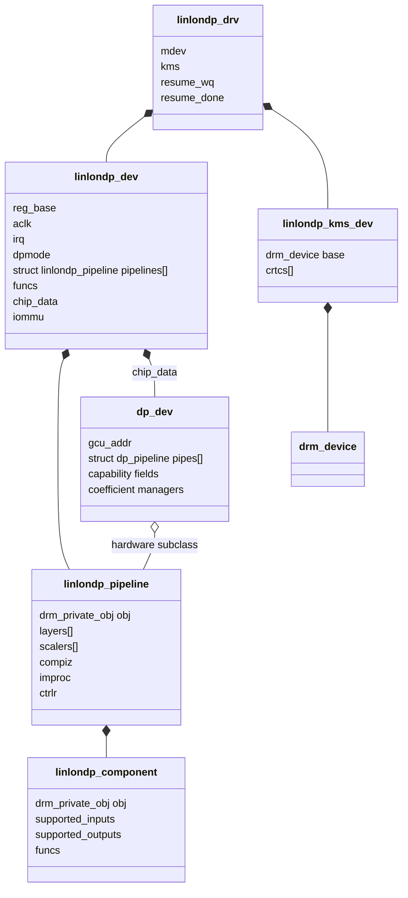
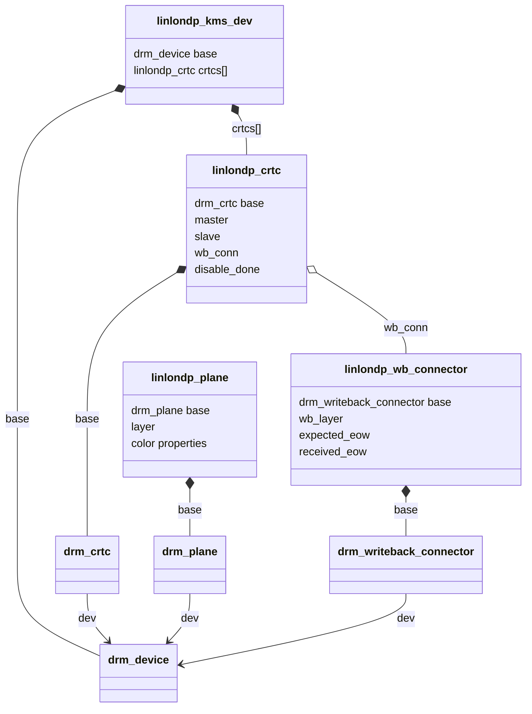
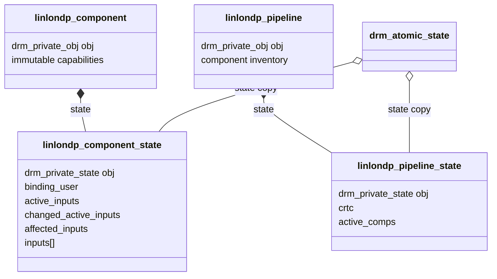
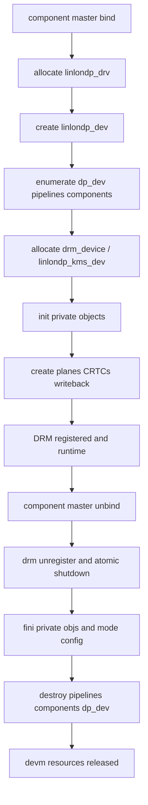

+++
date = '2026-11-24T12:14:24+08:00'
draft = false
title = 'Linlon DPU 数据结构与对象模型'
categories = ["Display"]
tags = ["Linux", "DPU"]
+++

# Linlon DPU 数据结构与对象模型

## 1. 三类对象

驱动的数据结构可分为三层：设备/硬件能力对象、DRM 公共对象、atomic 私有资源对象。

## 2. 顶层所有权

### `linlondp_drv`

它是 platform device 的 driver data，协调两个主要子系统：

- `struct linlondp_dev mdev`：硬件抽象、资源和 pipeline 图。
- `struct linlondp_kms_dev kms`：DRM device 及对用户空间可见的 KMS 对象。
- `resume_wq/resume_done`：system resume 时异步恢复 mode config，并阻止外部 atomic check 与恢复事务并发。

由 `linlondp_bind()` 用 `devm_kzalloc()` 分配；unbind 时先取消 resume work，再 detach KMS，最后 destroy mdev（`linlondp_drv.c:75`, `linlondp_drv.c:32`）。

### `linlondp_dev`

这是通用 core 的整机对象。它拥有 MMIO、engine clock、IRQ number、pipeline 数组和当前 display opmode；`funcs` 指向产品后端，`chip_data` 指向 `dp_dev`。

`mdev->lock` 只保护 `dpmode` 和与其耦合的时钟切换；component atomic state 的并发由 DRM atomic 框架负责。

### `dp_dev`

`dp_dev` 在 `dp_enum_resources`中 被kzalloc, 并和 `linlondp_dev *mdev` 互相绑定, 通过 `mdev->chip_data`。
这是硬件后端子类：`dp_pipeline` 把通用 `linlondp_pipeline` 嵌在首成员，增加 LPU/CU/DOU 寄存器基址；`dp_dev` 保存 GCU、各 pipeline、能力和 coefficient manager。`container_of()` 宏在通用层和硬件层间转换。

## 3. DRM 对象嵌入

嵌入式对象让 DRM core 持有基类指针，而驱动通过 `to_kdev/to_kcrtc/to_kplane` 回到私有对象。`linlondp_kms_dev` 由 `devm_drm_dev_alloc()` 整体分配；plane 和 writeback connector 分别由 `kzalloc()` 创建并在其 DRM destroy callback 释放。

* `linlondp_kms_dev` 是 Linlon KMS 的顶层私有结构，内部包含 `drm_device` 和多个 `linlondp_crtc`。
* `linlondp_crtc`、`linlondp_plane`、`linlondp_wb_connector` 分别在内部嵌入 DRM 的 `drm_crtc`、`drm_plane`、`drm_writeback_connector`，属于典型的 **DRM 对象扩展**。
* DRM 核心对象通过 `dev` 指针关联到所属的 `drm_device`，用于访问整个 DRM 设备的全局资源。
* `linlondp_crtc` 额外通过 `wb_conn` 关联 Writeback Connector，用于实现 DPU 输出回写。
* 整体可以理解为：**Linlon 私有结构体扩展 DRM 框架对象，`drm_device` 负责统一管理整个显示设备。**

## 4. Pipeline 与 component

`linlondp_pipeline` 是硬件资源容器；`linlondp_component` 是所有 layer/scaler/compiz/splitter/merger/improc/timing controller 的基类。

关键字段语义：

| 字段 | 语义 |
|---|---|
| `avail_comps` | pipeline 实际枚举出的 component ID bitmask |
| `supported_inputs/outputs` | 静态可连接拓扑，不代表本次 atomic 已连接 |
| `max_active_inputs/outputs` | 硬件同一时刻可启用的端口数量上限 |
| `standalone_disabled_comps` | 必须放到第二阶段关闭的 block；DP 设置为 improc + timing controller |
| `layer.right` | layer split 时的同能力右半 layer |
| `layer.sbs_slave` | side-by-side 时另一 pipeline 对应 layer |
| `master/slave` | 一个 CRTC 使用的输出 pipeline 与可选辅助 pipeline |

`linlondp_pipeline_assemble()` 根据 component 的 `supported_inputs` 反推上游 `supported_outputs`，清理不存在的输入，并建立 split/SBS 关联（`linlondp_pipeline.c:270`）。

## 5. Static object 与 atomic state 分离

静态对象描述“硬件能做什么”，state 描述“本次事务要怎么用”。这使多个 plane/CRTC/writeback 对共享 scaler 或跨 pipeline 资源的竞争，能在 atomic check 阶段失败并整体回滚，而不会污染当前硬件状态。

### `linlondp_component_state`

- `binding_user` 是当前资源使用者，可为 plane、CRTC 或 writeback connector。
- `inputs[]` 保存上游 component 和 output port，形成本次事务的数据流图。
- `active_inputs` 是新状态启用端口。
- duplicate state 时，旧 `active_inputs` 被复制到 `affected_inputs`，随后新 `active_inputs` 清零；check 过程重新声明需要的输入。因此旧有但未重新声明的输入自然成为 disabling input（`linlondp_private_obj.c:10`）。

### `linlondp_pipeline_state`

- `crtc` 表示 pipeline 本次绑定的 CRTC。
- `active_comps` 是本次使用的 component 集合。
- component state 没有聚合进 pipeline state，因为每个 component 自身就是独立 `drm_private_obj`，统一由 `drm_atomic_state` 管理。

## 6. DRM state 扩展

| 扩展 state | 增加的信息 |
|---|---|
| `linlondp_plane_state` | layer split、zorder list node、plane color blobs |
| `linlondp_crtc_state` | affected/active pipeline mask、clock ratio、SBS zorder、output color、protected mode |
| `linlondp_wb_connector_state` | writeback color encoding/range |

`linlondp_data_flow_cfg` 是用户态几何属性到 component state 之间的中间表示，包含 source/destination rectangle、rotation、scale/split、crop/overlap、blend 和上游 input。它存在的原因是一个 plane 可能拆成左右两条硬件 flow，且 rotation 需要按硬件能力规范化，因此不能直接把 `drm_plane_state` 当作单个 block 的配置。

## 7. 生命周期

需要注意 devm 与显式 cleanup 混用：很多对象使用 devm 分配，但代码仍显式 `devm_kfree/devm_iounmap/devm_clk_put`。因此阅读错误路径时应以函数中的 cleanup 顺序为准，不能只按 devres 自动释放推断。

## 8. 并发与同步对象

- `mdev->lock`：串行化 opmode/aclk/pxlclk 变化。
- DRM `event_lock`：保护 pending vblank event 和 `disable_done` 指针。
- `resume_done` completion：system resume 的异步 mode restore 与外部 atomic check 同步。
- `disable_done` completion：等待 GCU FLIP IRQ，尤其用于 active-to-active modeset 和两阶段 disable。
- `received_eow` atomic bitmask：SBS writeback 等待 master/slave 两个 pipeline 都产生 EOW 后才完成 job。

## 9. 对象模型结论

最重要的所有权区别是：`linlondp_dev/pipeline/component` 拥有硬件能力和寄存器身份；DRM objects 拥有用户可见语义；`drm_atomic_state` 暂时拥有每次提交的资源绑定。把三者混为一谈会误判 plane-layer 关系和 commit 时机。
